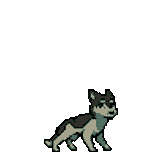

<!-- Header Neon & Clean -->

  <!-- GIF do Lupi / Enigma do Medo no PC -->
    
   

  # Olá! Meu nome é Elyy 👋
  ### **AI Systems Engineer & Full-Stack Architect**

  

    Engenharia de software moderna focada na convergência entre <b>Sistemas Distribuídos</b> e <b>Inteligência Artificial Aplicada</b>. 
    Construção de grafos com agentes autônomos (LangGraph), pipelines assíncronos de visão computacional, inferência local (vLLM / llama.cpp) e arquiteturas resilientes baseadas em Clean Architecture e DDD.
  

  <!-- Links / Redes -->
  
  
  

 

  

---

### 💻 Especialidades & Foco de Engenharia

* **Agentes & Grafos de Decisão (LangGraph):** Orquestração de fluxos autônomos, roteamento semântico, máquinas de estado para conformidade arquitetural e pipelines auto-remediativos de infraestrutura.
* **Visão Computacional & Inferência Distribuída:** Execução paralela com YOLOv8 e ONNX Runtime desacoplados via mensageria (RabbitMQ), além de pipelines OCR de precisão (PaddleOCR).
* **LLMOps & Inferência Local de Alto Desempenho:** Gateways adaptativos de roteamento dinâmico entre runtimes (vLLM GPU KV-Cache vs llama.cpp GGUF Edge), otimização de latência e privacidade estrita de dados.
* **Observabilidade & Arquitetura Limpa:** Padrões estritos de Clean Architecture, Domain-Driven Design (DDD), rastreabilidade com OpenTelemetry, Prometheus e Grafana, e automação via GitHub Actions.

---

### 🛠️ Tecnologias & Ferramentas

  

---

### 🚀 Principais Projetos de Portfólio

| Projeto | Stack Tecnológica | O que resolve |
| :--- | :--- | :--- |
| **📑 [Doc Semantic Equivalence Engine](https://github.com/Elyyihz/doc-semantic-equivalence-engine)** | `FastAPI`, `LangGraph`, `vLLM`, `Qdrant`, `PaddleOCR`, `Angular 17+` | Motor de equivalência semântica e conformidade legal com RAG assíncrono e busca vetorial densa. |
| **🎥 [Distributed Video Inference Pipeline](https://github.com/Elyyihz/distributed-video-inference-pipeline)** | `FastAPI`, `RabbitMQ`, `YOLOv8`, `ONNX Runtime`, `PostgreSQL`, `Angular 17+` | Pipeline distribuído para processamento de vídeo em lote com workers paralelos e mensageria AMQP. |
| **🚨 [Telemetry Anomaly Autonomous Agent](https://github.com/Elyyihz/telemetry-anomaly-autonomous-agent)** | `Python`, `LangGraph`, `llama.cpp (GGUF)`, `OpenTelemetry`, `Prometheus`, `Jaeger` | Agente autônomo que correlaciona métricas time-series e traces distribuídos para diagnóstico SRE. |
| **🛡️ [AI Augmented SAST Auditor](https://github.com/Elyyihz/ai-augmented-sast-auditor)** | `Python CLI`, `Bandit`, `GGUF Local`, `GitHub Actions (SARIF)` | Ferramenta de auditoria estática com IA em pipelines CI/CD, eliminando falsos positivos e gerando SARIF. |
| **⚡ [Dynamic LLM Inference Router](https://github.com/Elyyihz/dynamic-llm-inference-router)** | `FastAPI`, `OpenTelemetry`, `Prometheus`, `Grafana`, `vLLM`, `llama.cpp` | API Gateway compatível com OpenAI que roteia requisições dinamicamente entre runtimes por complexidade e latência. |
| **🏛️ [Clean Arch Multi-Agent Validator](https://github.com/Elyyihz/clean-arch-multi-agent-validator)** | `Python`, `LangGraph`, `AST Parser`, `Clean Architecture` | Orquestrador multi-agente para auditoria da Regra de Inversão de Dependência e geração de tabelas de escrita/leitura. |
| **📊 [Calculadora IIM & UrbanFlow](https://github.com/Elyyihz/calculadora-iim)** | `React 18`, `TypeScript`, `FastAPI`, `Docker Compose`, `ESG Analytics` | Plataforma institucional e analítica para quantificação do Índice de Impacto de Mobilidade corporativa. |

---

### 🎧 Ouvido Agora

  

---

### 📊 Estatísticas do Perfil

  
  

  
  

---
<!-- Footer -->

